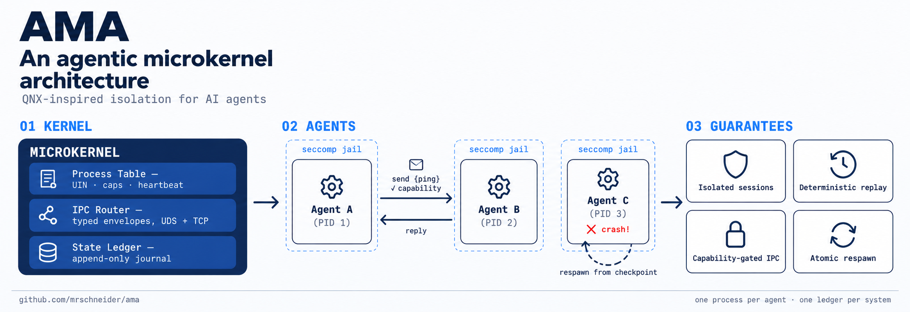

# AMA — Agentic Microkernel Architecture

<p align="center">
  
</p>

A microkernel architecture for reliable multi-agent systems, translated
from the QNX Neutrino microkernel design into the world of AI agent
execution: agents are **OS processes**, IPC is **typed message passing**
over Unix Domain Sockets, global state is an **append-only ledger**,
failures are contained by **isolation** and healed by **atomic respawn
from the last checkpoint**.

Everything below is **implemented and verified by running it**: the
experiment in `experiments/` executes the real kernel with 5 real agent
processes and asserts every behaviour from the ledger — see
[Verified results](#verified-results).

## A protocol run

```
ama serve --manifest manifest.json --agentd ./ama-agentd   # the Executive
```

Each agent in the manifest is spawned as its own OS process (`ama-agentd
--task <task.json>`): it registers on the kernel's UDS socket, then
executes its task — `send`, `wait`, `checkpoint`, `sleep`, `loop`,
`crash` — talking to the kernel and to other agents ONLY through typed
envelopes.

## What the kernel guarantees (v0.1)

**Minimal Executive (§1)** — the kernel holds only: the process table
(UIN, PID, capabilities, last heartbeat), the IPC router, and the
append-only ledger. Agents never write global state; they checkpoint
THEIR OWN state into the ledger and are recovered from it.

**Typed message passing (§3)** — every envelope is validated against a
strict per-kind schema by the kernel: `register`, `heartbeat` (with
`executing`/`blocked` phase — the watchdog distinguishes infinite
reasoning loops from legitimate I/O waits), `send`, `checkpoint`,
`done`. A malformed envelope is refused with a reason and journaled.

**Capability-based access (§3)** — an agent can only send to a target
listed in its process-table grants. A refused send is a journaled
security event (`cap_denied`), never a silent drop.

**Watchdog + fail-fast recovery (§4)** — heartbeat timeout AND a
progress watchdog (same reasoning step for K sweeps while `executing`)
kill the suspect with the reason journaled. Respawn is atomic: a fresh
process inherits the last ledger checkpoint and resumes. A respawn
budget turns persistent crashers into `dead` instead of restarting
forever.

**Isolation (§2)** — each agent is a separate PID; its ephemeral memory
dies with the process. cgroup v2 memory/CPU limits are applied
best-effort when `/sys/fs/cgroup/ama` is writable.

**Tool Execution Jail (§2)** — `ama-agentd` jails ITSELF with
seccomp-bpf (raw BPF, no libseccomp): a denylist of host-dangerous
syscalls — `ptrace`, `mount`, module loading, `bpf`, `userfaultfd`,
`setns`, `unshare`… — returns EPERM to the jailed process, with
`PR_SET_NO_NEW_PRIVS` set so privileges can never be regained. Tools
run inside the same filter via `ama jail -- <cmd>` (PATH-resolved).
Differential probe: unjailed `ptrace(TRACEME)` returns 0; the identical
call inside the jail returns EPERM.

**Strict allowlist seccomp (§3)** — `ama jail --strict` flips the
filter to default-DENY with an explicit x86_64 allowlist, and
`socket()` is allowed ONLY for `AF_UNIX`: the differential probe shows
`socket(AF_INET)` returning EPERM while `socket(AF_UNIX)` works — the
kernel is the agent's ONLY channel.

**Network-remote IPC (§3)** — the kernel accepts agents over TCP
(`tcp_port` in the manifest) with the IDENTICAL envelope contract and
capability checks; an agent list `transport: "tcp"` in its spec. The
round trip crosses transports AND wire formats transparently
(experiment 003).

**Binary wire format (§3)** — every connection speaks either JSON
lines (v0.1) or length-prefixed msgpack (`0xFF` magic), decided by the
first byte; the kernel answers each connection in ITS format and
delivers cross-format messages by translating at the target's wire.

**User-namespace tier (§2, MicroVM frontier)** — `ama jail --userns`
runs the tool in a fresh user+mount namespace before the seccomp filter
(uid 0 inside, host ownership unchanged). Gated by host policy: hosts
that forbid unprivileged user namespaces get an explicit SKIP, not a
fake pass.

**Hot capability renegotiation (§3)** — the operator grants and revokes
capabilities AT RUNTIME over a control connection (`ama grant --name m
--caps send:c` / `ama revoke`); agents can never reach the control
channel. Every grant and revocation is journaled; a send attempt after
revocation is refused again, even for a capability that previously
worked.

**Agent observability** — agents journal notes into the ledger
(`note`/`agent_note` events), so agent-visible failures (a seccomp
refusal, a capability denial) appear in the same auditable stream as
kernel events.

## Verified results (experiments 001 + 002)

`experiments/experiment_001_isolation.sh` (14 s end-to-end, 5 real
processes):

```
PASS: isolation: 5 agents spawned as distinct OS processes
PASS: schema: malformed envelope rejected (invalid json)
PASS: ipc: a (uin 1) received b's ping
PASS: ipc: b (uin 0) received a's pong
PASS: ipc: round trip completed both sides (a and b tasks completed)
PASS: capabilities: m's send to c was refused and journaled
PASS: capabilities: no message was delivered on the denied attempt
PASS: watchdog: infinite reasoning loop detected via progress watchdog
PASS: watchdog: respawn budget enforced (d died after the budget)
PASS: recovery: c checkpointed n=0 before the external kill
PASS: recovery: the kernel detected the external kill and respawned c from the ledger
PASS: recovery: c resumed FROM the checkpoint (n=1 after respawn)
PASS: isolation: parallel agents unaffected by c's crash and d's loop
EXPERIMENT_001: PASS
```

`experiments/experiment_002_caps_seccomp.sh` (12 s end-to-end):
```
PASS: seccomp control: unjailed ptrace succeeds (0)
PASS: seccomp: ptrace refused (EPERM=1) INSIDE the jail
PASS: hot caps: initial send denied (before the grant)
PASS: hot caps: operator GRANTED send:c at runtime
PASS: hot caps: the previously denied send was DELIVERED after the grant
PASS: hot caps: operator REVOKED send:c at runtime
PASS: hot caps: send AFTER the revoke was refused again (zero deliveries of attempt 3)
PASS: observability: agent notes are journaled into the ledger
EXPERIMENT_002: PASS  (40 ledger events)
```

Scenario: `b` pings `a` (typed envelope, capability-checked, journaled);
`a` pongs back and both complete. `c` checkpoints, is killed externally
(`kill -9`, the OOM/operator path), resumes from its ledger checkpoint
at the exact step it died on, and completes. `d` runs an infinite
reasoning loop — the progress watchdog detects the stuck step in
`executing` phase, kills it, and exhausts the respawn budget. `m`
attempts to reach an agent it has no capability for — refused and
journaled. All five ran as distinct OS processes.

## Deliberately not implemented (v0.3)

- **Full MicroVM (Firecracker-class)**: the deepest isolation tier.
  Today: OS process + seccomp (denylist AND strict allowlist) + user
  namespace + best-effort cgroup v2. The remaining frontier is a real
  VM per agent for fully hostile tool code — the user-namespace tier
  above is its unprivileged first step.
- **FlatBuffers/protobuf**: msgpack (length-prefixed frames) shipped as
  the binary wire; protobuf remains an option, not a requirement — the
  enforcement point is the kernel's schema check, not the encoder.

Git history: `3dd35d8` v0.1.0 (kernel MVP), v0.2.0 (seccomp jails +
hot capabilities), v0.3.0 (strict allowlist, TCP transports, msgpack
wire, user-namespace tier).

## Layout

- `ama-core/` — the kernel library: envelopes, ledger, process table,
  router, watchdog, supervisor, sandbox
- `ama-agentd/` — the agent-side process (`ama-agentd`)
- `ama-cli/` — the `ama` binary (`serve`, `ps`)
- `experiments/` — runnable E2E proof + task manifests
- `docs/research/qnx-microkernel.md` — the QNX design sources this
  architecture is translated from, with the deliberate-scope notes

## Build

```bash
cargo build            # ama-core (lib) + ama-agentd + ama
cargo test             # unit tests
bash experiments/experiment_001_isolation.sh   # isolation + watchdog + recovery
bash experiments/experiment_002_caps_seccomp.sh # seccomp jail + hot capabilities
bash experiments/experiment_003_transports.sh  # TCP + msgpack + allowlist + userns
```

## License

Apache-2.0.
