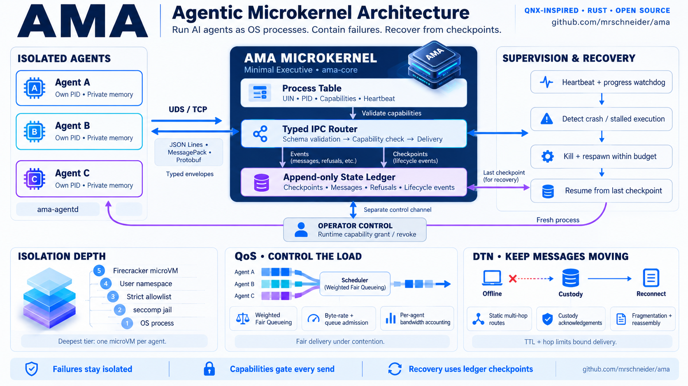

# AMA — Agentic Microkernel Architecture

[](https://github.com/mrschneider/ama/actions/workflows/ci.yml)
[](https://github.com/mrschneider/ama/releases/latest)
[](LICENSE)

**Run AI agents as OS processes. Contain every failure. Prove every guarantee.**

AMA is a microkernel for reliable multi-agent systems — the QNX Neutrino
design translated into agent execution. Every agent gets a hard
operating-system boundary instead of a framework's trust.

<p align="center">
  
</p>

| Agent concern | AMA mechanism |
|---|---|
| Agents are isolated | Own OS process, up to a full Firecracker microVM |
| Agents communicate | Typed message passing over UDS/TCP, capability-checked |
| State is trusted | Global state is an **append-only ledger** — agents never write it |
| Agents fail | Detected, killed, **respawned from the last checkpoint** |
| Agents misbehave | seccomp jails, allowlists, user namespaces, microVMs |

## Why AMA

- **Reliability by construction** — the watchdog kills a crashed or
  stuck agent; respawn is atomic from the ledger checkpoint, and a
  respawn budget turns persistent crashers into `dead`.
- **Security you can audit** — every send is capability-checked,
  refusals are journaled events (never silent drops), and operators
  grant/revoke capabilities at runtime on a channel agents cannot reach.
- **Isolation in tiers** — OS process → seccomp jail → strict allowlist
  → user namespace → Firecracker microVM, one VM per agent.
- **Three wires, one kernel** — JSON lines, msgpack (`0xFF`), Protobuf
  (`0x0A`), over UDS **and** TCP, translated at the target.
- **Observability for free** — agent notes land in the same append-only
  ledger as kernel events: one auditable stream.

## Quick start

```bash
# prebuilt static binaries (gnu + musl) on every release
BASE=https://github.com/mrschneider/ama/releases/latest/download
curl -LO $BASE/ama-x86_64-linux-musl.tar.gz
tar xzf ama-x86_64-linux-musl.tar.gz        # ama + ama-agentd + docs + experiments

# or from source (fetches VM assets, builds the static agentd)
./setup.sh
ama serve --manifest manifest.json --agentd ./ama-agentd
```

Each agent spawns as its own OS process and only speaks typed envelopes
(`send`, `wait`, `checkpoint`, `sleep`, `loop`, `crash`). Every send,
refusal, kill, respawn and checkpoint lands in the ledger.

## How it works

- **Minimal Executive** — the kernel holds a process table (UIN, PID,
  capabilities, heartbeat), a typed IPC router, and the append-only
  ledger. Agents checkpoint their own state; the kernel only recovers it.
- **Typed envelopes** — `register`, `heartbeat` (with `executing`/
  `blocked` phase), `send`, `checkpoint`, `done`; schema violations are
  refused with a reason and journaled.
- **Capabilities gate every send** — grants live in the process table,
  denials are journaled `cap_denied`, and `ama grant`/`ama revoke` change
  them at runtime.
- **Five isolation tiers** — OS process (+ cgroup v2 best-effort),
  self-applied seccomp-BPF jail, default-deny allowlist (AF_UNIX only),
  user namespace, Firecracker microVM with a private tap subnet per
  agent; tiers 2–4 ship as `ama jail --strict|--userns`.

  
- **QoS** — weighted fair queueing on a per-tick link budget,
  per-sender admission control, bandwidth accounting (`ama qos`).
- **DTN** — custody for offline agents with TTL, multi-hop relays,
  custody acks, fragmentation and reassembly.
- **Watchdog** — heartbeat timeout plus a progress watchdog (same
  reasoning step for K sweeps); respawn inherits the checkpoint and
  resumes at the exact step.

Full contract — WFQ math, DTN journal events, wire formats, tier-by-tier
detail — lives in the [kernel reference](docs/architecture/kernel-reference.md).

## Proven results

Seven end-to-end experiments run in CI on every push (`005_microvm` is
excluded — it needs `/dev/kvm`, which hosted runners do not expose);
every validator **fails closed**: a FAIL line exits nonzero (guarded by
`tests/validators_fail_closed.py`), and every assertion comes from the
ledger.

| Experiment | Proves |
|---|---|
| `001_isolation` | 5 real processes, capability denial, watchdog, checkpoint resume after `kill -9` |
| `002_caps_seccomp` | seccomp jail (EPERM inside, control outside), runtime grant → deliver, revoke → refuse |
| `003_transports` | TCP + msgpack + strict allowlist + user namespace |
| `004_wires` | three wire formats on ONE kernel, translated at the target |
| `005_microvm` | Firecracker tier, one VM per agent (documented; needs `/dev/kvm`) |
| `006_qos_dtn` | rate limits + custody taken and drained for an offline agent |
| `007_qos_suite` | WFQ weights under contention, admission control, accounting |
| `008_dtn_routing` | multi-hop relays, custody acks, fragmentation |
| `009_authority` | NEGATIVE tests: session identity (no cross-agent impersonation), registration tokens, task caps do not become grants, operator socket separation, revocations survive re-registration, custody ownership |

Sample: `EXPERIMENT_001: PASS` — 13 assertions in 14 s across 5 distinct
OS processes. Full transcripts: [kernel reference](docs/architecture/kernel-reference.md);
run any of them with `bash experiments/<name>.sh`.

## Not implemented on purpose

- **Trusted execution** — tiers are host-enforced; Firecracker assumes
  a trusted guest kernel image.
- **Live migration** — respawn boots a fresh VM from the checkpoint.
- **QoS beyond this kernel** — a per-tick byte budget, not a shaped NIC.
- **DTN beyond static routes** — no discovery, no bundle-layer crypto
  (scope note in [SECURITY.md](SECURITY.md)).

## Documentation

- [Kernel reference](docs/architecture/kernel-reference.md) — full
  guarantees, verified transcripts, release history, experiment catalogue
- [Concept-to-code map](docs/architecture/concept-to-code.md)
- [QNX design sources](docs/research/qnx-microkernel.md)
- [CONTRIBUTING.md](CONTRIBUTING.md) — experiments are the executable
  specification; `cargo fmt` + `clippy -D warnings` are CI-enforced
- [SECURITY.md](SECURITY.md) — private reporting and the isolation
  model's boundaries

## Layout

```
ama-core/       kernel library: envelopes, ledger, table, router, watchdog, sandbox
ama-agentd/     the agent-side process
ama-cli/        the `ama` binary (serve, ps, jail, grant, revoke)
vm/             microVM tier (assets fetched by ./setup.sh, not committed)
experiments/    runnable E2E proof + task manifests
```

## License

Apache-2.0.