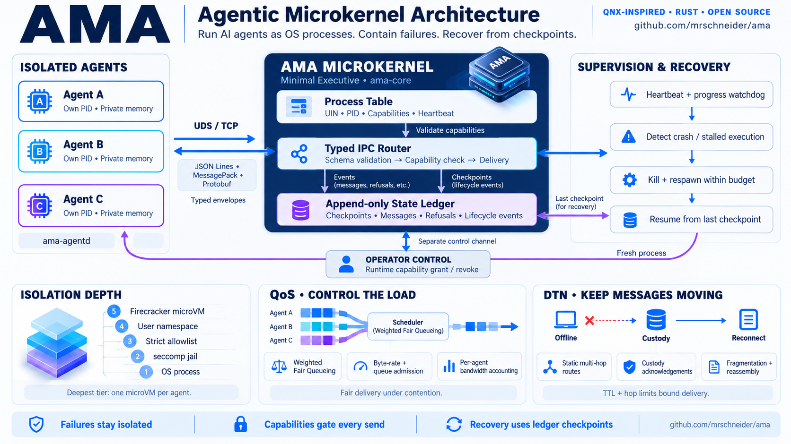
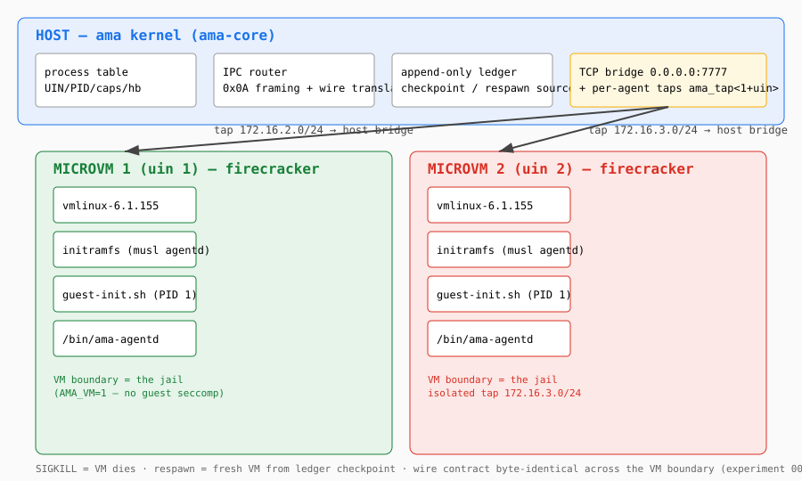

# AMA — Agentic Microkernel Architecture

[](https://github.com/mrschneider/ama/actions/workflows/ci.yml)
[](https://github.com/mrschneider/ama/releases/latest)
[](LICENSE)

**Run AI agents as OS processes. Contain every failure. Prove every guarantee.**

AMA is a microkernel for reliable multi-agent systems — the QNX Neutrino
design translated into agent execution. Every agent gets a hard
operating-system boundary instead of a framework's trust.

<p align="center">
  
</p>

| Agent concern | AMA mechanism |
|---|---|
| Agents are isolated | Own OS process, up to a full Firecracker microVM |
| Agents communicate | Typed message passing over UDS/TCP, capability-checked |
| State is trusted | Global state is an **append-only ledger** — agents never write it |
| Agents fail | Detected, killed, **respawned from the last checkpoint** |
| Agents misbehave | seccomp jails, allowlists, user namespaces, microVMs |

## Why AMA

- **Reliability by construction** — the watchdog kills a crashed or
  stuck agent; respawn is atomic from the ledger checkpoint, and a
  respawn budget turns persistent crashers into `dead`.
- **Security you can audit** — every send is capability-checked in the
  same critical section that delivers it, refusals are journaled events
  (never silent drops), and operators grant/revoke capabilities at
  runtime on a channel agents cannot reach.
- **Isolation in tiers** — OS process → seccomp jail → strict allowlist
  → user namespace → Firecracker microVM, one VM per agent.
- **Three wires, one kernel** — JSON lines, msgpack (`0xFF`), Protobuf
  (`0x0A`), over UDS **and** TCP, translated at the target.
- **Bounded by construction** — connection, outbound-byte, custody-byte
  and journal-segment budgets are configured in the manifest and
  enforced; a refused message is journaled, never silently dropped.
- **Observability for free** — agent notes land in the same append-only
  ledger as kernel events: one auditable stream. **Operators** poll it
  without touching agents: `ama ps` (table), `ama inspect --name m` (one
  entry), `ama stats` (journal growth + table + queue + budgets, one JSON
  line), `ama logs --last N` (the journal tail, filtered) and
  `ama rotate --keep N` (roll and retain the journal).

## Quick start

```bash
# prebuilt static binaries (gnu + musl) on every release
BASE=https://github.com/mrschneider/ama/releases/latest/download
curl -LO $BASE/ama-x86_64-linux-musl.tar.gz
tar xzf ama-x86_64-linux-musl.tar.gz        # ama + ama-agentd + docs + experiments

# or from source (fetches VM assets, builds the static agentd)
./setup.sh
ama serve --manifest manifest.json --agentd ./ama-agentd
```

Each agent spawns as its own OS process and only speaks typed envelopes
(`register`, `heartbeat`, `send`, `checkpoint`, `done`, `note`, plus the
DTN `relay`/`custody_ack`). Every send, refusal, kill, respawn and
checkpoint lands in the ledger.

The reference agent (`ama-agentd`) runs a **scripted** task: a JSON list
of steps (`checkpoint`, `send`, `wait`, `note`, `sleep`, `loop`, `crash`,
`relay`) with `"repeat": true` for a sustained load. It is the harness
the experiments use — the kernel is the product, and any process that
speaks the envelope protocol can be an agent.

## How it works

- **Minimal Executive** — the kernel holds a process table (UIN, PID,
  capabilities, heartbeat), a typed IPC router, and the append-only
  ledger. Agents checkpoint their own state; the kernel only recovers it.
- **Typed envelopes** — `register`, `heartbeat` (with `executing`/
  `blocked` phase), `send`, `checkpoint`, `done`; schema violations are
  refused with a reason and journaled.
- **Capabilities gate every send** — grants live in the process table,
  denials are journaled `cap_denied`, and `ama grant`/`ama revoke` change
  them at runtime. The check and the delivery decision are **one**
  critical section, so a revocation can never slip between them.
- **Five isolation tiers** — OS process (+ cgroup v2 best-effort),
  self-applied seccomp-BPF jail, default-deny allowlist (AF_UNIX only),
  user namespace, Firecracker microVM with a private tap subnet per
  agent; tiers 2–4 ship as `ama jail --strict|--userns`.

  
- **QoS** — weighted fair queueing on a per-tick link budget,
  per-sender admission control, bandwidth accounting (`ama qos`).
- **DTN** — custody for offline agents with TTL, multi-hop relays,
  custody acks, fragmentation and reassembly.
- **Watchdog** — heartbeat timeout plus a progress watchdog (same
  reasoning step for K sweeps); respawn inherits the checkpoint and
  resumes at the exact step.
- **Bounded resources** — the manifest's `kernel.resources` block caps
  connections, per-peer connections, control connections, handshake and
  idle timeouts, outbound bytes (global and per agent), custody bytes
  (global, per sender, per destination) and the journal segment size.
  Every refusal is journaled.

Full contract — WFQ math, DTN journal events, wire formats, tier-by-tier
detail — lives in the [kernel reference](docs/architecture/kernel-reference.md).

## The authority model

AMA does not trust an agent because it *claims* an identity. Three
independent gates decide who may do what:

1. **A per-instance registration token.** The kernel mints it when it
   spawns an agent and hands it to that process only. `register` is
   refused without it — a stale, forged or dead identity cannot be
   claimed, even by a process that knows the agent's name and PID.
2. **An operator credential.** Every control verb
   (`grant`, `revoke`, `restart`, `stats`, `logs`, `rotate`, `ps`)
   requires `AMA_OPERATOR_TOKEN`. Same-uid agents can open the control
   socket; they never hold the secret, so every verb is refused for
   them.
3. **A separate control door.** The operator verbs live on
   `<socket>.ctl` (mode 0600), never on the agent listener. The kernel
   checks the peer's uid **and** refuses any peer whose PID is one of the
   agents it spawned — before reading a single byte of the request.

The kernel also drops its own `/proc` readability (`PR_SET_DUMPABLE=0`)
and strips `AMA_OPERATOR_TOKEN` from every child environment, so the
credential is not reachable through the filesystem either.

## Operator surface

Every verb below is served **only** on the credential-gated control
socket, and the ones that change state are journaled.

| Command | What it gives you |
|---|---|
| `ama ps` | the process table: UIN, PID, state, respawns, caps, wire |
| `ama inspect --name m` | one entry — the same snapshot `ps` shows, filtered |
| `ama stats` | one JSON line: journal growth, table **by state**, delivery queue, both connection budgets, uptime |
| `ama logs --last N` | the journal tail, oldest first (`--event X`, `--uin N` filters) |
| `ama rotate --keep N` | roll the active segment now, retain the newest N archives (journaled as `ledger_rotated`) |
| `ama qos` | bandwidth accounting and queue state |
| `ama grant` / `ama revoke` | hot capability renegotiation |
| `ama restart --name m` | the authorized respawn of a dead identity |
| `ama jail [--strict\|--userns] -- cmd` | run a tool inside the seccomp jail |

`ama logs` reads the journal **backwards** in 8 KiB chunks over the
newest segment (and the archives behind it), so the last 20 events of a
2 GiB journal cost a few KiB, not a full scan. The internal rotation
snapshot never appears in the tail.

## Performance

Measured on the development host (Intel N100, 4 cores), release builds,
best-of-7 alternating runs of the same binaries. Reproduce with
`cargo run --release -p ama-core --example <name>`.

| Path | Before | After | Note |
|---|---|---|---|
| `ledger.append` | 3.45 µs | **3.26 µs** | 3 syscalls per append → **2** (`strace`: 1.50 M → 1.00 M over 500k appends): the handle's inode identity is cached at open time instead of re-derived per append, and the record is framed in a reused buffer |
| `route_send` (4 senders) | 144k msg/s | **150k msg/s** | the capability check, the destination snapshot and the queue handle are now **one** process-table pass (were three) |
| **agent step loop** (200 notes) | 2.10 s | **0.13 s** | **~16x**: the agent's inbox is a condvar, not a 10 ms poll — the ack was already queued long before the poll woke up |

To measure the current build, run these release benchmarks:

- `cargo run --release -p ama-core --example perf_bench` measures routing,
  ledger appends, checkpoint lookup and journal tail queries.
- `cargo run --release -p ama-core --example wire_bench` measures JSON
  send acknowledgement round trips over a Unix socket. Add `-- 25` to
  measure pipelined throughput. Both modes verify every send reply.
- `inbound_bench` measures the parse, validate, clone and serialize chain.
  `statx_bench` compares metadata syscall variants.

## Proven results

**Ten** end-to-end experiments run in CI on every push (`005_microvm` is
excluded — it needs `/dev/kvm`, which hosted runners do not expose);
every validator **fails closed**: a FAIL line exits nonzero (guarded by
`tests/validators_fail_closed.py`), and every assertion comes from the
ledger.

| Experiment | Proves |
|---|---|
| `001_isolation` | 5 real processes, capability denial, watchdog, checkpoint resume after `kill -9` |
| `002_caps_seccomp` | seccomp jail (EPERM inside, control outside), runtime grant → deliver, revoke → refuse |
| `003_transports` | TCP + msgpack + strict allowlist + user namespace |
| `004_wires` | three wire formats on ONE kernel, translated at the target |
| `005_microvm` | Firecracker tier, one VM per agent (documented; needs `/dev/kvm`) |
| `006_qos_dtn` | rate limits + custody taken and drained for an offline agent |
| `007_qos_suite` | WFQ weights under contention, admission control, accounting |
| `008_dtn_routing` | multi-hop relays, custody acks, fragmentation |
| `009_authority` | NEGATIVE tests: session identity (no cross-agent impersonation), registration tokens, task caps do not become grants, operator socket separation, revocations survive re-registration, custody ownership |
| `010_resource_recovery` | the failure/recovery probes: frame bounds, read deadlines, connection admission, byte reservations, custody limits, checkpoint recovery, segment rotation, durability failures |
| `011_operator_surface` | The operator verbs: `ama stats` (journal growth + table by state + budgets), `ama inspect` (the same entry `ps` shows), `ama logs` (the journal tail, filtered), `ama rotate --keep N` (roll + retention, journaled), and the credential gate on the new verbs |

Sample: `EXPERIMENT_001: PASS` — 14 assertions in 14 s across 5 distinct
OS processes; `EXPERIMENT_011: PASS` — 37 assertions covering the whole
operator surface. Full transcripts:
[kernel reference](docs/architecture/kernel-reference.md);
run any of them with `bash experiments/<name>.sh`.

## Not implemented on purpose

- **Trusted execution** — tiers are host-enforced; Firecracker assumes
  a trusted guest kernel image.
- **Live migration** — respawn boots a fresh VM from the checkpoint.
- **QoS beyond this kernel** — a per-tick byte budget, not a shaped NIC.
- **DTN beyond static routes** — no discovery, no bundle-layer crypto
  (scope note in [SECURITY.md](SECURITY.md)).
- **A general-purpose agent runtime** — `ama-agentd` is a scripted
  reference agent; the kernel speaks the envelope protocol, not a model.

## Documentation

- [Kernel reference](docs/architecture/kernel-reference.md) — full
  guarantees, verified transcripts, release history, experiment catalogue
- [Resource and recovery validation](docs/architecture/resource-recovery-validation.md) —
  the measured numbers and the failure-probe coverage behind them
- [Concept-to-code map](docs/architecture/concept-to-code.md)
- [QNX design sources](docs/research/qnx-microkernel.md)
- [CONTRIBUTING.md](CONTRIBUTING.md) — experiments are the executable
  specification; `cargo fmt` + `clippy -D warnings` are CI-enforced
- [SECURITY.md](SECURITY.md) — private reporting and the isolation
  model's boundaries

## Layout

```
ama-core/       kernel library: envelopes, ledger, table, router, watchdog, sandbox
  examples/     the benchmarks (perf_bench, wire_bench, inbound_bench, statx_bench, ...)
ama-agentd/     the agent-side process (the scripted reference agent)
ama-cli/        the `ama` binary (serve, ps, inspect, stats, logs, rotate, qos,
                grant, revoke, restart, jail)
vm/             microVM tier (assets fetched by ./setup.sh, not committed)
experiments/    runnable E2E proof + task manifests
docs/           architecture, kernel reference, research notes
```

## License

Apache-2.0.
