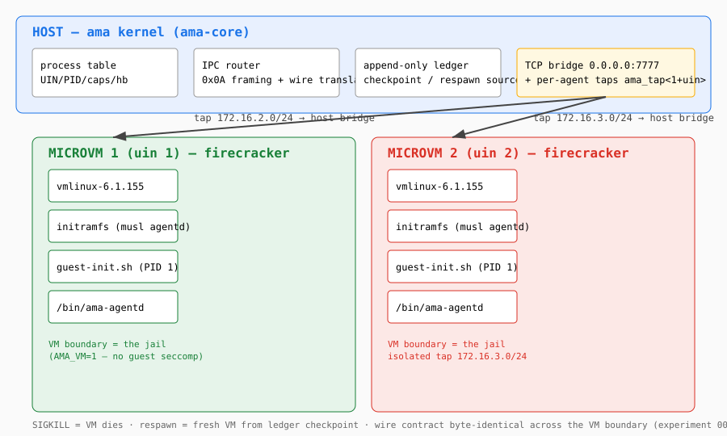

# AMA — Agentic Microkernel Architecture

**Run AI agents as OS processes. Contain every failure. Prove every guarantee.**

AMA is a microkernel for reliable multi-agent systems — a faithful
translation of the QNX Neutrino microkernel design into the world of AI
agent execution.

Instead of a framework that trusts agents to behave, AMA gives every
agent a **hard operating-system boundary**:

| Agent concern | AMA mechanism |
|---|---|
| Agents are isolated | Each agent is its own OS process (up to a full Firecracker microVM) |
| Agents communicate | Typed message passing over UDS/TCP, capability-checked |
| State is trusted | Global state is an **append-only ledger** — agents never write it |
| Agents fail | The kernel detects, kills, and **respawns from the last checkpoint** |
| Agents misbehave | seccomp jails, strict allowlists, user namespaces, microVMs |

Everything below is **implemented and verified by running it** — five
real agent processes, end-to-end experiments, every assertion taken
from the ledger. See [Verified results](#verified-results).

## Getting started

```bash
# 1. Fetch the external VM assets (Firecracker, guest kernel, busybox)
#    and build the static agentd — the repo does not commit binaries
./setup.sh

# 2. Start the kernel ("the Executive") with a manifest of agents
ama serve --manifest manifest.json --agentd ./ama-agentd
```

## Contributing & security

- `CONTRIBUTING.md` — the rules of the road: experiments are the
  executable specification, `cargo fmt`/`clippy -D warnings` are CI-
  enforced, the kernel stays minimal, refusals are journaled.
- `SECURITY.md` — how to report vulnerabilities privately, plus the
  explicit scope and design boundaries of the isolation model.
- `.github/workflows/ci.yml` — fmt, clippy (debug *and* release),
  unit tests, and experiments 001–004 on every push/PR; the microVM
  experiment is documented but not run in CI (needs `/dev/kvm`).
- `.github/workflows/release.yml` — tag-driven releases: verify →
  cross-compile gnu+musl → checksums → GitHub Release.

Then each agent is spawned as its own OS process (`ama-agentd --task
task.json`) and executes its task — `send`, `wait`, `checkpoint`,
`sleep`, `loop`, `crash` — talking to the kernel and to other agents
ONLY through typed envelopes. Watch the ledger: every send, refusal,
kill, respawn and checkpoint is there.

## Why it matters

- **Reliability by construction.** A crashed or stuck agent is killed by
  the watchdog and respawned atomically from its ledger checkpoint — it
  resumes at the exact step it died on. A respawn budget turns
  persistent crashers into `dead` instead of restarting forever.
- **Security you can audit.** Every send is capability-checked against
  the process table; refusals are journaled security events, never
  silent drops. Operators grant and revoke capabilities *at runtime*
  from a control channel agents cannot reach.
- **Isolation in tiers.** Pick the depth: OS process → seccomp jail →
  strict allowlist (Unix sockets only) → user namespace →
  **Firecracker microVM**, one VM per agent with its own tap subnet.
- **Three wire formats, one kernel.** JSON lines, length-prefixed
  msgpack (`0xFF`), and Protobuf (`0x0A`) — decided per connection, with
  the kernel translating cross-wire at the target. Over UDS **and** TCP
  with the identical envelope contract.
- **Observability for free.** Agents journal notes into the same ledger
  as kernel events, so a seccomp refusal or capability denial appears in
  the same auditable stream.

## What the kernel guarantees

**Minimal Executive (§1)** — the kernel holds only the process table
(UIN, PID, capabilities, last heartbeat), the IPC router, and the
append-only ledger. Agents checkpoint their *own* state into the ledger
and are recovered from it.

**Typed message passing (§3)** — every envelope is validated against a
strict per-kind schema: `register`, `heartbeat` (with
`executing`/`blocked` phase — the watchdog distinguishes infinite
reasoning loops from legitimate I/O waits), `send`, `checkpoint`,
`done`. Malformed envelopes are refused with a reason and journaled.

**Capability-based access (§3)** — an agent can only send to targets
listed in its process-table grants. Refused sends are journaled
(`cap_denied`).

**QoS: rate limits + priority (§3)** — an agent declares
`max_msgs_per_sec` and the kernel holds a **per-sender** token bucket: a
bursty agent is throttled on its own sends without starving the others.
Refusals are journaled (`qos_throttled`) — backpressure is never silent.
`priority` (0 = highest) orders the destination's deferred queue.

**DTN: store-and-forward custody (§3)** — an agent may declare
`dtn: true`. A send to that agent while it is disconnected (killed, dead,
not yet up) does NOT fail: the kernel takes **custody** of the bundle,
holds it with a TTL, and delivers it on the destination's next
registration — before the welcome, in priority order. Every transition is
journaled (`dtn_stored`, `dtn_delivered`, `dtn_expired`). This is the
Bundle Protocol idea reduced to what a kernel can honestly implement.

**Watchdog + fail-fast recovery (§4)** — heartbeat timeout *and* a
progress watchdog (same reasoning step for K sweeps while `executing`)
kill the suspect with the reason journaled. Respawn is atomic: a fresh
process inherits the last checkpoint and resumes.

**Isolation tiers (§2)** — from shallow to deep:

1. **OS process** — each agent is a separate PID; ephemeral memory dies
   with the process. cgroup v2 memory/CPU limits are applied
   best-effort when `/sys/fs/cgroup/ama` is writable.
2. **Seccomp jail** — `ama-agentd` jails *itself* with raw seccomp-BPF
   (no libseccomp): a denylist of host-dangerous syscalls — `ptrace`,
   `mount`, module loading, `bpf`, `userfaultfd`, `setns`, `unshare` —
   returns EPERM, with `PR_SET_NO_NEW_PRIVS` so privileges can never be
   regained. Tools run inside the same filter via `ama jail -- <cmd>`.
   Differential probe: unjailed `ptrace(TRACEME)` succeeds; the same
   call inside the jail returns EPERM.
3. **Strict allowlist** — `ama jail --strict` flips to default-DENY with
   an explicit x86_64 allowlist where `socket()` is allowed **only for
   AF_UNIX**: `socket(AF_INET)` returns EPERM while `socket(AF_UNIX)`
   works — the kernel is the agent's only channel.
4. **User namespace** — `ama jail --userns` runs the tool in a fresh
   user+mount namespace before the seccomp filter (uid 0 inside, host
   ownership unchanged). Hosts that forbid unprivileged user namespaces
   get an explicit SKIP, not a fake pass.
5. **MicroVM (Firecracker-class)** — the deepest tier. An agent with
   `isolation: "microvm"` runs inside its **own Firecracker microVM**.
   The PID the kernel watches *is* the whole VM (the boot script `exec`s
   firecracker); SIGKILL tears the VM down, respawn boots a fresh VM
   from the ledger checkpoint. Per-agent tap networking
   (`172.16.<1+uin>.0/24` — VMs cannot see each other's traffic),
   per-agent initramfs (static musl agentd + task baked in), kernel
   bridge listening on `0.0.0.0` for the tap. The VM boundary replaces
   the seccomp jail inside the guest; the three-wire contract is
   byte-identical across the VM boundary.

<p align="center">
  
</p>

**Network-remote IPC (§3)** — the kernel accepts agents over TCP
(`tcp_port` in the manifest) with the identical envelope contract and
capability checks; an agent sets `transport: "tcp"` in its spec. The
round trip crosses transports **and** wire formats transparently.

**Binary wire formats (§3)** — every connection speaks JSON lines, or
length-prefixed msgpack (`0xFF` magic), or Protobuf (`0x0A` magic),
decided by the first byte. The kernel answers each connection in *its*
format and translates cross-format messages at the target's wire.

**Hot capability renegotiation (§3)** — the operator grants and revokes
capabilities at runtime over a control connection (`ama grant --name m
--caps send:c` / `ama revoke`); agents can never reach the control
channel. A send attempt after revocation is refused again — even for a
capability that previously worked.

**Agent observability** — agents journal notes into the ledger
(`note`/`agent_note` events), so agent-visible failures appear in the
same auditable stream as kernel events.

## Verified results (experiments 001 + 002)

`experiments/experiment_001_isolation.sh` (14 s end-to-end, 5 real
processes):

```
PASS: isolation: 5 agents spawned as distinct OS processes
PASS: schema: malformed envelope rejected (invalid json)
PASS: ipc: a (uin 1) received b's ping
PASS: ipc: b (uin 0) received a's pong
PASS: ipc: round trip completed both sides (a and b tasks completed)
PASS: capabilities: m's send to c was refused and journaled
PASS: capabilities: no message was delivered on the denied attempt
PASS: watchdog: infinite reasoning loop detected via progress watchdog
PASS: watchdog: respawn budget enforced (d died after the budget)
PASS: recovery: c checkpointed n=0 before the external kill
PASS: recovery: the kernel detected the external kill and respawned c from the ledger
PASS: recovery: c resumed FROM the checkpoint (n=1 after respawn)
PASS: isolation: parallel agents unaffected by c's crash and d's loop
EXPERIMENT_001: PASS
```

`experiments/experiment_002_caps_seccomp.sh` (12 s end-to-end):
```
PASS: seccomp control: unjailed ptrace succeeds (0)
PASS: seccomp: ptrace refused (EPERM=1) INSIDE the jail
PASS: hot caps: initial send denied (before the grant)
PASS: hot caps: operator GRANTED send:c at runtime
PASS: hot caps: the previously denied send was DELIVERED after the grant
PASS: hot caps: operator REVOKED send:c at runtime
PASS: hot caps: send AFTER the revoke was refused again (zero deliveries of attempt 3)
PASS: observability: agent notes are journaled into the ledger
EXPERIMENT_002: PASS  (40 ledger events)
```

Scenario: `b` pings `a` (typed envelope, capability-checked,
journaled); `a` pongs back and both complete. `c` checkpoints, is
killed externally (`kill -9`, the OOM/operator path), resumes from its
ledger checkpoint at the exact step it died on, and completes. `d`
runs an infinite reasoning loop — the progress watchdog detects the
stuck step, kills it, and exhausts the respawn budget. `m` attempts to
reach an agent it has no capability for — refused and journaled. All
five ran as distinct OS processes.

Further experiments: `003_transports` (TCP + msgpack + allowlist +
userns), `004_wires` (three wires on ONE kernel), `005_microvm`
(Firecracker tier), `006_qos_dtn` (rate limiting + store-and-forward
custody for an offline destination).

## Deliberately not implemented (v0.4)

- **Trusted execution** — all tiers are host-enforced. A VM booting a
  malicious kernel is not contained (Firecracker assumes a trusted
  guest kernel image; the vmlinux here is the Firecracker CI build).
- **Live migration** — the microVM tier is cold: respawn = fresh VM
  from the checkpoint, no hot migration between hosts.
- **Full QoS suite** — no weighted fair queueing, no admission control,
  no bandwidth accounting: only a per-sender token bucket and a
  priority-ordered custody queue.
- **DTN routing** — custody is single-hop kernel-side only: no
  multi-hop relays, no custody acknowledgements, no bundle
  fragmentation or re-assembly.

Git history: `3dd35d8` v0.1.0 (kernel MVP), v0.2.0 (seccomp jails + hot
capabilities), v0.3.0 (strict allowlist, TCP transports, msgpack wire,
user-namespace tier), v0.4.0 (protobuf wire + Firecracker microVM
tier), v0.5.0 (per-sender QoS + DTN custody).

## Layout

- `ama-core/` — the kernel library: envelopes, ledger, process table,
  router, watchdog, supervisor, sandbox
- `ama-agentd/` — the agent-side process (`ama-agentd`)
- `ama-cli/` — the `ama` binary (`serve`, `ps`, `jail`, `grant`,
  `revoke`)
- `vm/` — the microVM tier: `boot_agent.sh` (per-agent tap +
  firecracker), `assemble_initramfs.sh` (per-agent initramfs),
  `guest-init.sh` (guest PID 1); `vm/bin/firecracker`,
  `vm/vmlinux-6.1.155` and `vm/agentd-static` are fetched/built by
  `./setup.sh` (binaries are not committed)
- `experiments/` — runnable E2E proof + task manifests
- `docs/research/qnx-microkernel.md` — the QNX design sources this
  architecture is translated from, with the deliberate-scope notes

## Build

```bash
cargo build            # ama-core (lib) + ama-agentd + ama
cargo test             # unit tests
bash experiments/experiment_001_isolation.sh   # isolation + watchdog + recovery
bash experiments/experiment_002_caps_seccomp.sh # seccomp jail + hot capabilities
bash experiments/experiment_003_transports.sh  # TCP + msgpack + allowlist + userns
bash experiments/experiment_004_wires.sh       # protobuf wire: 3 wires on ONE kernel
bash experiments/experiment_005_microvm.sh     # Firecracker microVM tier (needs /dev/kvm + ufw allow 172.16.0.0/12)
bash experiments/experiment_006_qos_dtn.sh     # per-sender rate limits + DTN custody for an offline agent
```

## License

Apache-2.0.
